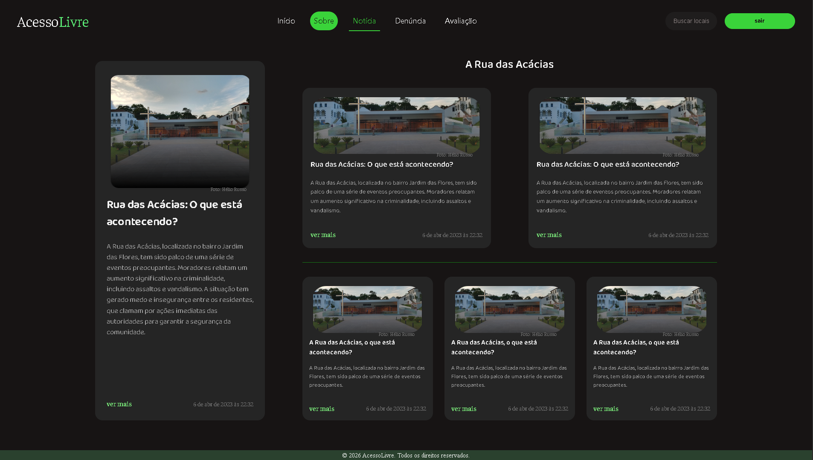

# Programação de Funcionalidades

Implementação da aplicação descritas por meio dos requisitos codificados. 

[Utilize a estrutura abaixo para cada funcionalidade entregue na etapa]

### Título da funcionalidade

[Adicione imagem da funcionalidade/tela]

#### Requisito atendido

[RF-X: adicione a descrição do requisito atendido]

#### Artefatos da funcionalidade

[Adicione os nomes dos arquivos relacionados ao desenvolvimento da funcionalidade]

#### Estrutura de Dados

[Caso exista estrutura de dados, adicione aqui]

#### Instruções de acesso

[Adicione as orientações de acesso à funcionalidade]

#### Responsável

[Adicione nome do responsável pelo desenvolvimento da funcionalidade]

### Página de Avaliação

#### Requisito atendido

RF-01: A aplicação deve oferecer funcionalidade como avaliação por estrelas e uso de tags, permitindo que o usuário classifique o local de forma positiva ou negativa quanto à acessibilidade ou relate eventuais problemas.

#### Artefatos da funcionalidade

- pagina-avaliação.css

- pagina-avaliação.html

- pagina-avaliação.js

- db.js

#### Estrutura de Dados

const availableLocations = [
  { name: "Restaurante La Tavola", state: "SP", keywords: "sao paulo massa italiano" },
  { name: "Restaurante La Tavola", state: "RJ", keywords: "rio de janeiro praia" },
  { name: "Restaurante La Tavola", state: "MG", keywords: "minas gerais bh belo horizonte" },
  { name: "Shopping DiamondMall", state: "MG", keywords: "belo horizonte shopping lourdes" },
  { name: "Parque Ibirapuera", state: "SP", keywords: "sao paulo lazer parque" },
  { name: "Copacabana Palace", state: "RJ", keywords: "rio hotel copacabana" }
];

const defaultReviews = [
  {
    id: 1,
    name: "Restaurante La Tavola",
    state: "SP",
    author: "Wellington Ranniery",
    avatar: "/codigo-fonte/Imagens/Fotopessoa1.png",
    image: "https://dynamic-media-cdn.tripadvisor.com/media/photo-o/12/51/77/a2/intro-restaurant-plaza.jpg?w=900&h=500&s=1",
    comment: "Tive o prazer de jantar no Restaurante La Tavola na última terça-feira e confesso que superou todas as minhas expectativas. Desde o momento em que entramos, fomos recebidos com muita cordialidade pela equipe, que nos conduziu prontamente a uma mesa aconchegante.",
    keywords: "restaurante la tavola welington ranniery sao paulo"
  }]
#### Instruções de acesso

- Acesse a página inicial
- Clique em "Entrar/Criar conta"
- Preencha e-mail e senha
- Clique no botão "Entrar"
- Acesse a pagina de avaliação localizada na navbar
- Preencha todos campos necessários
- Clique no botão para submeter a avaliação

#### Responsável

- Wellington Ranniery Parreiras Leite

### Pesquisa

#### Requisito atendido

RF-03	A aplicação deve possibilitar pesquisa para que o usuário possa buscar os locais mais bem avaliados por categoria.

#### Artefatos da funcionalidade

- searchL.css
- searchL.html
- searchL.js
- db.js

#### Estrutura de Dados

const availableLocations = [
  { name: "Restaurante La Tavola", state: "SP", keywords: "sao paulo massa italiano" },
  { name: "Restaurante La Tavola", state: "RJ", keywords: "rio de janeiro praia" },
  { name: "Restaurante La Tavola", state: "MG", keywords: "minas gerais bh belo horizonte" },
  { name: "Shopping DiamondMall", state: "MG", keywords: "belo horizonte shopping lourdes" },
  { name: "Parque Ibirapuera", state: "SP", keywords: "sao paulo lazer parque" },
  { name: "Copacabana Palace", state: "RJ", keywords: "rio hotel copacabana" }
];

const defaultReviews = [
  {
    id: 1,
    name: "Restaurante La Tavola",
    state: "SP",
    author: "Wellington Ranniery",
    avatar: "/codigo-fonte/Imagens/Fotopessoa1.png",
    image: "https://dynamic-media-cdn.tripadvisor.com/media/photo-o/12/51/77/a2/intro-restaurant-plaza.jpg?w=900&h=500&s=1",
    comment: "Tive o prazer de jantar no Restaurante La Tavola na última terça-feira e confesso que superou todas as minhas expectativas. Desde o momento em que entramos, fomos recebidos com muita cordialidade pela equipe, que nos conduziu prontamente a uma mesa aconchegante.",
    keywords: "restaurante la tavola welington ranniery sao paulo"
  }]

#### Instruções de acesso

- Acesse a página inicial
- Clique em "Entrar/Criar conta"
- Preencha e-mail e senha
- Clique no botão "Entrar"
- Clique na pagina barra de pesquisa na navbar
- Pesquise por nome ou estado

*********************

#### Responsável

- Wellington Ranniery Parreiras Leite

## Notícias (Deslogado)

**Requisito atendido**

RF-04: o sistema deve ter uma aba de notícias onde estão dispostas informações 
como últimas notícias e anúncios de eventos alertas contendo as informações de acessibilidade.

**Artefatos da funcionalidade**

- codigo-fonte/Noticias/noticias.html
- codigo-fonte/Noticias/noticias.css

**Estrutura de Dados**

Não se aplica.

**Instruções de acesso**

1. Acesse a página inicial
2. Clique em "Notícia" na navbar

**Responsável**

Amanda Gomes Costa Estevam

---

## Notícias (Logado)

**Requisito atendido**

RF-04: o sistema deve ter uma aba de notícias onde estão dispostas informações 
como últimas notícias e anúncios de eventos alertas contendo as informações de acessibilidade.

**Artefatos da funcionalidade**

- codigo-fonte/Noticias-Logado/noticiasLO.html
- codigo-fonte/Noticias-Logado/noticiasLO.css

**Estrutura de Dados**

Não se aplica.

**Instruções de acesso**

1. Acesse a página inicial
2. Faça login com e-mail e senha
3. Clique em "Notícia" na navbar

**Responsável**

Amanda Gomes Costa Estevam

> **Links Úteis**:
> - [Trabalhando com HTML5 Local Storage e JSON](https://www.devmedia.com.br/trabalhando-com-html5-local-storage-e-json/29045)
> - [JSON Tutorial](https://www.w3resource.com/JSON)
> - [JSON - Introduction (W3Schools)](https://www.w3schools.com/js/js_json_intro.asp)
> - [JSON Tutorial (TutorialsPoint)](https://www.tutorialspoint.com/json/index.htm)

