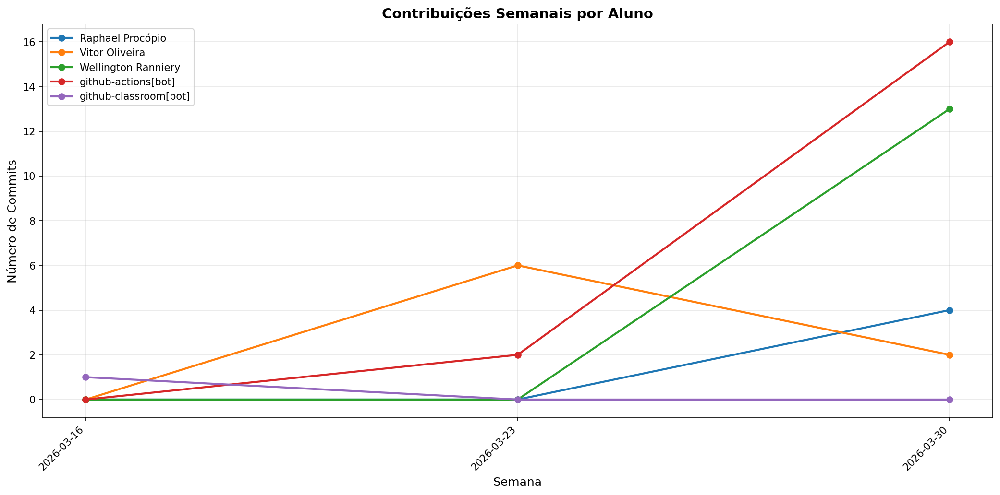

# 📊 Relatório de Contribuições do Projeto

**Última atualização:** 06/04/2026 21:51

---

## 📈 Resumo Geral de Contribuições

| Aluno                 |   Commits |   Linhas+ |   Linhas- |   Arquivos |   Docs Commits |   Docs Arquivos |
|-----------------------|-----------|-----------|-----------|------------|----------------|-----------------|
| Raphael Procópio      |         4 |        94 |        30 |          1 |              4 |               1 |
| Vitor Oliveira        |         8 |        70 |        39 |          3 |              7 |               1 |
| Wellington Ranniery   |        13 |        67 |        77 |          4 |             13 |               2 |
| github-actions[bot]   |        18 |       118 |        67 |          3 |             18 |               1 |
| github-classroom[bot] |         1 |       774 |         0 |         19 |              1 |               3 |

## 📅 Contribuições Semanais (Todo o Semestre)

**2026-03-30**: Raphael Procópio: 4, Vitor Oliveira: 2, Wellington Ranniery: 13, github-actions[bot]: 16

**2026-03-23**: Vitor Oliveira: 6, github-actions[bot]: 2

**2026-03-16**: github-classroom[bot]: 1

## 📊 Visualização Gráfica

## ℹ️ Observações

- **Commits**: Número total de commits realizados

- **Linhas+**: Linhas de código adicionadas

- **Linhas-**: Linhas de código removidas

- **Arquivos**: Número de arquivos únicos modificados

- **Docs Commits**: Commits em arquivos de documentação

- **Docs Arquivos**: Arquivos de documentação modificados

---

*Relatório gerado automaticamente via GitHub Actions*
